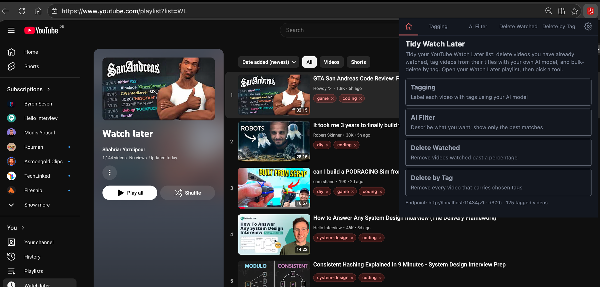

# Tidy Watch Later

[](https://github.com/yazdipour/tidy-watch-later/actions/workflows/test.yml)
[](LICENSE)

<p align="center">
  
</p>

A Chrome extension that tidies your YouTube **Watch Later** playlist. Delete what you've already watched, tag videos with **your own AI model**, filter the list by meaning, and bulk-delete by tag.

Nothing goes to a third party: the AI features talk only to the endpoint **you** configure (a local server works great), and there is no analytics or telemetry.

> Tidy Watch Later is an independent project. It is not affiliated with, endorsed by, or sponsored by YouTube or Google.

## Features

| Tool | What it does |
|---|---|
| **Tagging** | Give it a list of tags. Your model scores every video against each tag from its title and channel, and the best matches (up to your max, above your minimum probability) appear as small chips on the video. A filter bar on the page lets you view one tag at a time. Each chip has a ✕ to drop a wrong tag. |
| **AI Filter** | Describe what you want ("short beginner-friendly Rust tutorials"). Your model scores each video, and only the best matches stay visible, each with a "92% match" label. The probability slider re-filters the page instantly. |
| **Delete Watched** | Removes videos you have already watched past a percentage you choose. |
| **Delete by Tag** | Removes every video carrying the tags you pick. Run **Tagging** first. |

Every long-running tool has a **Limit** (default 10) and a **Stop** button, shows a progress bar, and keeps running if you close the popup. Reopening the popup picks the run back up.

## Install

There is no store listing yet, so load it unpacked:

1. Clone or download this repository.
2. Open `chrome://extensions` and turn on **Developer mode**.
3. Click **Load unpacked** and select the repository folder.
4. Open your [Watch Later playlist](https://www.youtube.com/playlist?list=WL) and click the extension icon.

Requires a Chromium browser with Manifest V3 support.

## Set up your AI endpoint

The tagging and AI Filter tools need a server that implements the Systemone API (see [below](#the-systemone-endpoint)). Delete Watched works without one.

1. Open the **Settings** tab (the gear icon).
2. Enter the **endpoint base URL** (for example `http://localhost:11434/v1`) and the **model** name. The API key is optional.
3. Click **Test connection**, then **Save**.

### If the test fails with 403 or "Failed to fetch"

Your server has to allow requests from the extension. Add the extension's origin to your provider's allowed CORS origins. The exact value is shown in Settings after a failed test. It looks like `chrome-extension://<extension id>`, or use `chrome-extension://*` for any extension.

For Ollama:

```bash
OLLAMA_ORIGINS="chrome-extension://*" ollama serve
```

If the server is on another machine it must also listen on the network (for Ollama, `OLLAMA_HOST=0.0.0.0`).

## The Systemone endpoint

The extension calls `POST {base}/systemone` with one yes/no question per item:

```jsonc
// request
{
  "model": "your-model",
  "state": "Request: beginner Rust tutorials\nFor each numbered video below, judge ...\n[0] Learn Rust in 1 hour | channel: Fireship | duration 59:12 | ...",
  "questions": {
    "<videoId>__t0": { "type": "noul", "instructions": "Does [0] match the request?" }
  }
}

// response
{ "answers": { "<videoId>__t0": { "type": "noul", "noul": 0.97 } } }
```

`noul` is a probability from 0 to 1. Question names encode the video ID, so answers map back deterministically.

**Question limits are discovered, not assumed.** If the server rejects a request for having too many questions (for example `questions must contain 1–64 fields`), the extension reads the limit from the error, re-plans only the unsent work, and caches the limit per endpoint and model. If the message has no number it halves the batch until it fits. Network errors, 429s and 5xx responses are retried for the failing batch only. A video whose answers only partly arrived is never saved, so a re-run retries it.

## Privacy

Full policy: [PRIVACY.md](PRIVACY.md). In short:

- **What is sent, and where:** video titles, channel names, durations, the "views • age" text, how much of each video you watched, and list positions go to **the endpoint you configured**, and nowhere else.
- **What is stored:** your settings, tags and scores, in `chrome.storage.local` in your browser. Your API key (if you set one) is stored the same way, unencrypted. Don't reuse a valuable key.
- **No telemetry.** There is no analytics and no remote code.

| Permission | Why |
|---|---|
| `activeTab`, `scripting` | Run the delete tools on the Watch Later tab you're looking at. |
| `storage` | Save settings, tags and scores. |
| `localhost` / `127.0.0.1` | Reach a local AI server. |
| optional: any `http(s)` host | Requested only when you save or test a non-local endpoint. |
| content script on `youtube.com` | Show tag chips and the filter bar, and run the scans. |

## Limitations

- **YouTube's markup changes often.** The selectors for titles, durations, progress bars and menus were written against the current Watch Later page and may break. If something stops working, please open an issue with a snippet of the page's HTML.
- **Removal is English-only.** Deleting finds the "Remove from…" menu item by its text, so YouTube must be set to English.
- **The Watch Later page shows no "date added"**, so that can't be sent to the model. List position is sent instead.
- **Keep the tab visible during long runs.** Chrome throttles background tabs, and YouTube may not load more videos while the tab is hidden.
- **Deleting is permanent.** Videos removed from Watch Later are gone from the list.
- **AI results are probabilities, not facts.** Raise the minimum probability if you see odd matches.

## Development

There is no build step.

```bash
npm test        # unit tests for batching, limit discovery, retries and ranking
```

| File | Role |
|---|---|
| `manifest.json` | Extension manifest (MV3) |
| `popup.html`, `popup.css`, `tabs.js` | Popup UI and its tabs |
| `remove.js` | The removal engine and the Delete Watched tab |
| `content.js`, `content.css` | Runs on YouTube: chips, filter bar, tagging and AI scan loops |
| `background.js` | Talks to the AI endpoint (service worker) |
| `tagging.js` | Pure logic: batching, limit detection, retries, ranking. Unit-tested. |
| `tests/` | `node --test` suites |

To try a change, edit the files, click the reload icon on the extension at `chrome://extensions`, and refresh the YouTube tab.

## Contributing

Issues and pull requests are welcome. Please run `npm test` first and keep changes focused.

## License

[MIT](LICENSE). Bundles [Pico CSS](https://picocss.com) v2.0.6 (MIT) in `lib/`.
